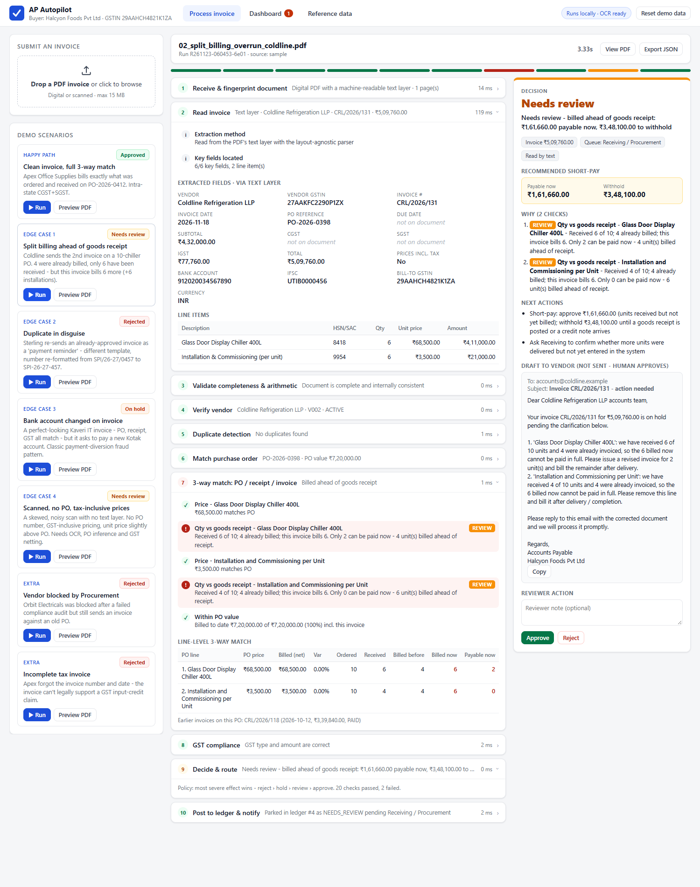
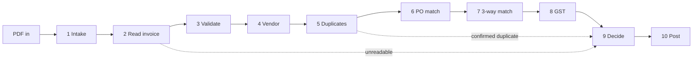

# AP Autopilot

My submission for the Zamp ASA case study, problem statement 1 (Finance / AP).

You give it a vendor invoice as a PDF. It reads the invoice, checks it against the company's vendor master, purchase orders, goods receipts and past invoices, and ends with one of four outcomes:

- **Approved**: everything checked out. It's booked to the ledger with a payment date based on the vendor's terms.
- **Needs review**: there's a specific problem a person has to look at. Where it can, the app works out what to do, for example how much can be paid now and how much to hold back.
- **On hold**: something looks like possible fraud (e.g. new bank details). Payment is frozen until someone verifies it by phone.
- **Rejected**: the invoice shouldn't be booked at all (a duplicate, a blocked vendor, missing mandatory fields). A note to the vendor is drafted.

You can watch each step happen in the browser, and every decision lists the checks that caused it.

Everything runs on your own machine. There's no API key, no paid service and no internet needed. Digital PDFs are read from their text layer, and scanned PDFs are read with an OCR model that ships inside the repo. Reading the invoice is kept separate from deciding what to do with it: the decision is always made by plain rules you can read in the code.



## Running it

You need Python 3.10 or newer.

```bash
cd ap-autopilot
python -m venv .venv
# Windows: .venv\Scripts\activate      macOS/Linux: source .venv/bin/activate
pip install -r requirements.txt
uvicorn app.main:app --port 8000
```

Then open http://localhost:8000. `run.ps1` (Windows) and `run.sh` (macOS/Linux) do the same steps for you.

The pill in the top-right corner should say "Runs locally · OCR ready". The first scanned invoice takes around 10 seconds on a laptop CPU. After that, the same file is read from a cache and is instant.

### Other ways to run

- Command line, same pipeline with coloured output: `python scripts/process_invoice.py samples/*.pdf --reset`
- Docker: `docker build -t ap-autopilot . && docker run -p 8000:8000 ap-autopilot` (I haven't been able to test the Docker build yet)
- Render: `render.yaml` is a blueprint, nothing to configure.
- Tests: `python -m pytest -q` (52 tests, about 20 seconds, no network needed)

## How an invoice moves through it



1. **Intake.** Rejects anything that isn't a readable PDF. Takes a SHA-256 hash of the file and checks whether it has a text layer (digital) or not (scanned).
2. **Read invoice.** For a digital PDF, the words and their positions come from the text layer. For a scan, they come from local OCR (RapidOCR running PaddleOCR models on the CPU). Either way the same parser turns them into invoice fields and line items. It doesn't rely on fixed column positions: a row counts as a line item when its numbers satisfy qty × rate = amount. On scans, GSTINs misread by OCR (I for 1, O for 0) are corrected using the GSTIN check digit. Text read with low confidence sends the invoice to review. Notes printed on the invoice, like "we have changed our bankers" or "payment reminder", are picked up and shown.
3. **Validate.** Invoice number, date and total must be present, since a GST tax invoice isn't valid without them. It must be billed to our GSTIN, the date can't be in the future or too old, and the maths has to add up: qty × rate per line, lines to subtotal, subtotal plus tax to total. Tax-inclusive pricing is handled. On a scan this is also the check that OCR read the numbers right.
4. **Vendor.** Finds the vendor by GSTIN, falling back to a fuzzy name match. Validates the GSTIN check digit, makes sure the GSTIN belongs to that vendor, checks the vendor is active, and compares the bank details on the invoice with the vendor master.
5. **Duplicates.** Same file, same invoice number once formatting is stripped (`SPI/26-27/0457` and `SPI-26-27-457` count as the same), or the same amount from the same vendor within 30 days. A confirmed duplicate stops the run here (see DESIGN.md for why).
6. **PO match.** Uses the PO quoted on the invoice. If there isn't one, it scores the vendor's open POs on how well the lines and amounts fit, and only picks one if it scores high enough and clearly beats the runner-up. Then it maps each invoice line to a PO line.
7. **3-way match.** For each line: is the price within tolerance of the PO (after taking GST out if prices include it)? Is the quantity within what was ordered? Is it within what's actually been received, minus what's already been billed? It also checks the PO's total value. If goods were billed before they arrived, it works out how much can be paid now.
8. **GST.** A vendor in the same state as us should charge CGST + SGST; a vendor in another state should charge IGST. It also checks the tax amount against the PO's tax rates. Get this wrong and the company can't claim the input tax credit.
9. **Decide.** The most serious result wins: rejected, then on hold, then needs review, then approved. Anything over ₹10 lakh needs Finance Controller sign-off even if it's clean.
10. **Post.** Approved invoices go in the ledger with a payment date. Review and hold items go in as pending, so a resent copy is still caught. Rejected invoices aren't posted. Vendor emails are drafted but never sent automatically.

All the thresholds are in one place: `Policy` in [`app/config.py`](app/config.py).

## Sample invoices

`samples/` has seven PDFs made by [`scripts/generate_samples.py`](scripts/generate_samples.py). I used three different invoice layouts so the parser couldn't get away with fixed positions, and made one invoice a deliberately bad scan (rotated, noisy, JPEG, no text layer). The reference data the checks run against is in [`data/`](data/): vendors, POs, PO lines, goods receipts and a small history of past invoices.

| File | What's going on | Expected result |
|---|---|---|
| `01_happy_path_apex_office.pdf` | A normal, clean invoice. PO quoted, goods received, same-state GST. | Approved, payment on 14 Dec (Net 30) |
| `02_split_billing_overrun_coldline.pdf` | Second invoice against a PO for 10 chillers. 4 were already billed and only 6 have arrived, but this invoice bills 6 more plus installation. On its own the invoice is perfect; the problem only shows up against past invoices and receipts. | Needs review. Pay ₹1,61,660 now (2 chillers + GST), hold back ₹3,48,100 |
| `03_duplicate_resubmission_sterling.pdf` | An invoice we already approved, resent as a "payment reminder" with a different layout and the number written differently. A plain exact-match check would miss it. | Rejected, vendor note drafted |
| `04_bank_change_kaveri_it.pdf` | Everything matches except the bank account, which is new. This is the usual payment-diversion fraud. The app doesn't email the vendor, because whoever sent the invoice may control that email. | On hold, sent to Treasury |
| `05_scanned_no_po_greenleaf.pdf` | Scanned, no PO number, prices include GST, one price 0.64% above the PO. It has to OCR the scan, work out the PO from two open POs, take GST out before comparing prices, and decide whether 0.64% is acceptable. | Needs review, only to confirm the PO it picked (PO-2026-0405, 96% vs 8%) |
| `06_blocked_vendor_orbit.pdf` | Vendor was blocked after a compliance audit | Rejected |
| `07_missing_fields_apex.pdf` | No invoice number and no date, so not a valid tax invoice | Rejected, vendor asked to reissue |

Note: once you've run a sample, running it again gets caught as a duplicate. That's the app doing its job. Click **Reset demo data** to start fresh.

## Tests

`python -m pytest -q` runs 52 tests, all offline. They cover:

- Helpers: GSTIN check digit and OCR repair, invoice-number normalising, Indian number and date formats, fuzzy matching.
- Reading: the parser on all three layouts, OCR on the scanned invoice (every field checked), scan detection, non-PDF uploads.
- Every sample producing the result in the table above, including exact short-pay amounts, resubmitting the same file and junk uploads.
- What happens when OCR fails (manual entry) and when it's unsure (review).
- Individual rules, using a hand-made reading of the invoice: price over tolerance, wrong GST type, a GSTIN belonging to a different vendor, and the approval limit.
- The API: upload, the live event stream, export, reviewer approve/reject, the note required to release a hold, stats, reset, and a path-traversal attempt.

## Where things are

```
app/
  config.py      thresholds and settings (.env)
  models.py      the invoice fields every check reads from
  extraction.py  intake and the parser (text layer or OCR words in, invoice out)
  ocr.py         local OCR for scanned pages, with a cache
  pipeline.py    the ten steps and the live event stream
  decision.py    final outcome, reasons, next steps, short-pay, vendor email
  reference.py   loads vendors / POs / receipts from CSV
  db.py          SQLite for run history and the AP ledger
  main.py        FastAPI routes and the UI
  static/        the front end (plain JS, no build step)
models/ocr/      the two OCR model files (about 6 MB)
data/            reference CSVs
samples/         the seven PDFs + scenarios.json
scripts/         sample generator and the command-line runner
tests/
docs/            DESIGN.md, DEMO_SCRIPT.md, screenshots
```

[docs/DESIGN.md](docs/DESIGN.md) explains the main decisions, assumptions and what's missing. [docs/DEMO_SCRIPT.md](docs/DEMO_SCRIPT.md) is the walkthrough I use for the 5-minute demo.
